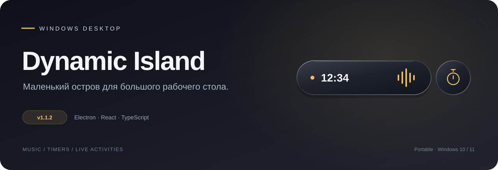
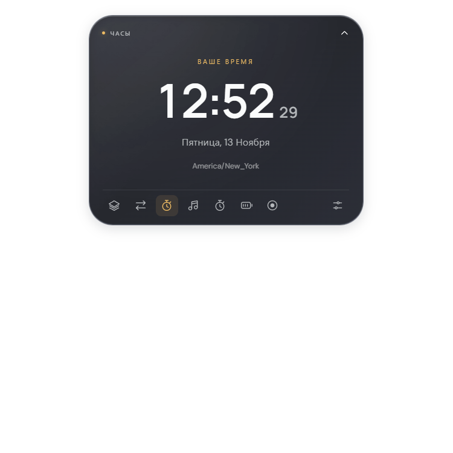
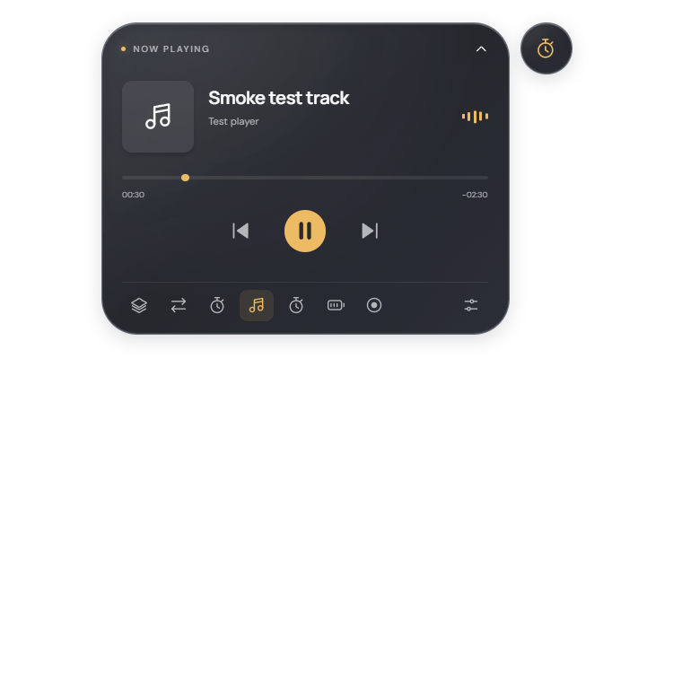
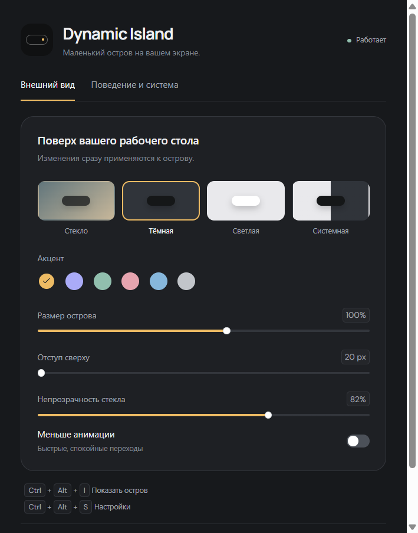

<div align="center">



<p>Музыка, таймеры и текущие активности — в одной аккуратной капсуле поверх рабочего стола.</p>

<a href="https://github.com/syslavka/dynamic-island-electron/releases/tag/v1.1.2"></a>


<br /><br />

**[Скачать для Windows](https://github.com/syslavka/dynamic-island-electron/releases/download/v1.1.2/Dynamic-Island-1.1.2.exe)** · [Все релизы](https://github.com/syslavka/dynamic-island-electron/releases) · [Сообщить об ошибке](https://github.com/syslavka/dynamic-island-electron/issues/new?template=bug_report.yml)

</div>

---

## Маленький остров. Полезные детали.

Dynamic Island — переносимое приложение для Windows. Оно остаётся поверх обычных окон, показывает время в простое и раскрывается, когда нужны детали или управление. В панели задач нет лишней кнопки: настройки и выход доступны через значок в трее.

Этот репозиторий содержит **Electron-версию 1.1.2** и её исходники. Интерфейс написан на React и TypeScript, интеграция с Windows — на Electron, PowerShell и C#.

| Возможность | Что работает |
| :--- | :--- |
| **Музыка и подкасты** | Название, исполнитель, обложка, звуковые волны, пауза, предыдущий/следующий трек и перемотка при поддержке плеером |
| **Автоматическое переключение** | Начало воспроизведения раскрывает плеер; после паузы остров возвращается к предыдущей активности |
| **Таймер и секундомер** | Пресеты 1/5/25 минут, пауза, сброс, системное уведомление о завершении при разрешении Windows |
| **Два острова** | Основная капсула и отдельный интерактивный круг для фоновой активности |
| **Запись экрана** | Выбор окна или монитора, запись без звука в WebM, остановка из острова |
| **Передача файлов** | Копирование с прогрессом и отменой; существующий файл заменяется после успешного завершения |
| **Системные события** | Питание, подключённые Bluetooth-устройства, доступные сведения о камере/микрофоне, активное приложение и управление отключением звука |
| **Оформление** | Стекло, тёмная, светлая и системная темы; акцент, размер, прозрачность, отступ, выбор экрана и уменьшение движения |

## Как выглядит

<div align="center">
<a href="docs/images/clock.png"></a>
<a href="docs/images/music-timer.png"></a>
<a href="docs/images/settings.png"></a>
</div>

Снимки интерфейса Electron. Музыкальный экран снят во встроенном тесте с тестовым треком; при обычном запуске данные приходят из медиасессии Windows. Нажмите на изображение, чтобы открыть его целиком.

## Скачать и запустить

1. Скачайте [Dynamic-Island-1.1.2.exe](https://github.com/syslavka/dynamic-island-electron/releases/download/v1.1.2/Dynamic-Island-1.1.2.exe).
2. Поместите файл в постоянную папку и запустите. Установка, Node.js и локальный сервер для готового приложения не нужны.
3. Нажмите на капсулу, чтобы раскрыть её. Для настроек используйте значок в трее или `Ctrl+Alt+S`.

**Требования:** Windows 10/11 x64. При первом запуске переносимая сборка распаковывает среду Electron, поэтому открытие может занять несколько секунд. Включайте автозапуск после перемещения `.exe` в постоянную папку.

Файл `SHA256SUMS.txt` в релизе позволяет проверить скачанную сборку:

```powershell
Get-FileHash .\Dynamic-Island-1.1.2.exe -Algorithm SHA256
```

## Управление

| Действие | Результат |
| :--- | :--- |
| Клик по капсуле | Раскрыть или свернуть |
| Удержание | Раскрыть подробную панель |
| Горизонтальный свайп | Переключить модуль |
| Клик по правому кругу | Открыть дополнительную активность |
| `Esc` | Свернуть панель |
| `Ctrl+Alt+I` | Показать остров |
| `Ctrl+Alt+S` | Открыть настройки |
| Правая кнопка по острову | Настройки и выход |
| Значок в трее | Настройки, выбор экрана и выход |

В простое видны только часы. Остров не исчезает от бездействия. Прозрачное пространство вокруг капсулы и её скруглённые углы пропускают клики к приложениям под ними.

## Разработка

Нужны **Windows x64**, **Node.js 22.12+** и npm. Windows-помощник обложек собирается системным компилятором .NET Framework; `scripts/build-native.mjs` запускает его автоматически.

```powershell
git clone https://github.com/syslavka/dynamic-island-electron.git
cd dynamic-island-electron
npm.cmd ci
npm.cmd run dev
```

| Команда | Назначение |
| :--- | :--- |
| `npm.cmd run dev` | Electron + Vite с обновлением интерфейса при редактировании |
| `npm.cmd test` | Тесты настроек, активностей, геометрии и файловых операций |
| `npm.cmd run build` | C#-помощник, TypeScript и production-интерфейс |
| `npm.cmd start` | Запуск собранного приложения |
| `npm.cmd run test:desktop` | Проверка настоящего окна Electron после сборки |
| `npm.cmd run dist` | Переносимый `release/Dynamic-Island-1.1.2.exe` |
| `npm.cmd run pack` | Распакованное приложение в `release/win-unpacked/` |

В PowerShell используется `npm.cmd`, чтобы команда работала и при запрете выполнения `.ps1`. Первой сборке нужен интернет для загрузки зависимостей и среды Electron. Проверка `test:desktop` использует отдельное хранилище и сохраняет локальные снимки в `.qa/`.

## Устройство проекта

```text
electron/       Окно, трей, Windows-интеграции, запись и файловые операции
src/            React-интерфейс, темы, анимации, модули и настройки
public/         Статические ресурсы
scripts/        Разработка, сборка C#-помощника и упаковка
docs/           Архитектура, снимки и описание исправления прозрачности
.github/        Проверки сборки, релизы и шаблон сообщения об ошибке
```

[Архитектура](docs/ARCHITECTURE.md) · [История изменений](CHANGELOG.md) · [Исправление серого прямоугольника](docs/visual-fix-1.1.1.md)

Production-интерфейс загружается из локальных файлов. Node.js в renderer отключён; используются sandbox, context isolation, ограниченный IPC и CSP без сетевых подключений. Настройки остаются в локальном профиле приложения.

## Что зависит от Windows

- Музыка доступна, когда плеер публикует системную медиасессию. Набор кнопок и точность позиции зависят от плеера.
- Камера и микрофон определяются по Windows ConsentStore: эти сведения могут запаздывать и не заменяют системный индикатор приватности.
- Заряд AirPods и других Bluetooth-устройств отображается только при наличии данных от драйвера; отсутствующие проценты не угадываются.
- Запись и прогресс копирования относятся к операциям, начатым в самом острове. Универсального определения звонков, маршрутов и записей сторонних программ здесь нет.
- Стеклянный стиль использует прозрачность, обводку и локальные отражения. Системный Acrylic исключён: он создавал серый прямоугольник вокруг острова. Оптическое преломление Apple Liquid Glass и размытие рабочего стола не заявляются.
- Эксклюзивные полноэкранные игры могут перекрывать обычные окна Windows.

## Нашли ошибку?

Откройте [issue](https://github.com/syslavka/dynamic-island-electron/issues/new?template=bug_report.yml): укажите версию Windows, масштаб экрана, шаги воспроизведения и ожидаемый результат. Прикладывая снимок, оставьте на нём только относящуюся к проблеме область.
